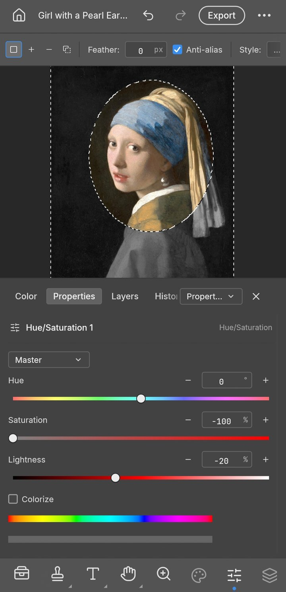

<h1 align="center">Niveta</h1>

<p align="center">
  <b>Image editing; an open-source, clean-room reimplementation of Adobe Photoshop, rebuilt in pure Rust.</b><br>
  Layers, masks, adjustment layers, layer styles, type, vectors, brushes and real PSD files,<br>
  in a native app written entirely in Rust. Open source, offline, and yours.
</p>

<p align="center">
  
  
  
  
</p>

<p align="center">
  Touch first, because this is an Android app: one APK, one Rust engine, the same PSD files<br>
  as the desktop editor it forked from. No Electron, no web view, no Java UI.
</p>

<table>
  <tr>
    <td width="25%" valign="top">
      <h3>Familiar by design</h3>
      The menus, shortcuts, panels and tools are where your hands expect them. If you know Photoshop, you already know Niveta.
    </td>
    <td width="25%" valign="top">
      <h3>Native and fast</h3>
      A wgpu canvas with a CPU fallback, copy-on-write tiles and multithreaded filters. No Electron, no web view, no waiting.
    </td>
    <td width="25%" valign="top">
      <h3>Real PSD files</h3>
      Open, edit and save layered Photoshop documents. Re-saving keeps the render of 307 of the 309 psd-tools test files.
    </td>
    <td width="25%" valign="top">
      <h3>Agent-ready</h3>
      Every action is a command, so anything you can tap, a script or an AI agent can do too through the same engine.
    </td>
  </tr>
</table>

<br>

## Features

Every screenshot here is the real app at work on public-domain art, rendered offscreen through its control channel.

<table>
  <tr>
    <td width="50%" valign="top">
      
      <br>
      <sub>Levels and Vibrance adjustment layers, with the live Histogram panel.<br><i>Impression, Sunrise</i>, Claude Monet, 1872</sub>
      <h3>Edit without regret</h3>
      Adjustment layers keep every edit live. Stack Levels, Curves, Vibrance, Hue/Saturation and a dozen more, mask them to an area, reorder them, or turn them off, and your original pixels never change.
      <br><br>
      <b>16 adjustment layers</b> that also apply directly to pixels, including Curves with per-channel editing, Levels with a live histogram, Black &amp; White, Channel Mixer, Gradient Map, Photo Filter, Selective Color and Color Lookup (.cube, .3dl, .look). Plus Shadows/Highlights, Replace Color, Match Color, HDR Toning, Desaturate and Equalize.
    </td>
    <td width="50%" valign="top">
      
      <br>
      <sub>Outer Glow and Stroke on a live type layer, in the Layer Style dialog.<br><i>Earthrise</i>, William Anders / NASA, 1968</sub>
      <h3>Styles that sell the shot</h3>
      Drop Shadow, Inner Shadow, Outer and Inner Glow, Bevel &amp; Emboss, Satin, Stroke, and Color, Gradient and Pattern Overlay, live on any layer, including type. Patterns come from a library (built-ins, Edit › Define Pattern, <code>.pat</code> import/export) and PSD <code>Patt</code> blocks.
      <br><br>
      Copy and paste styles between layers, hide all effects at once, and open styles straight from your PSDs, rendered to match Photoshop.
    </td>
  </tr>
  <tr>
    <td width="50%" valign="top">
      
      <br>
      <sub>An elliptical selection becomes the mask of a Hue/Saturation layer, so only the face keeps its color.<br><i>Girl with a Pearl Earring</i>, Johannes Vermeer, c. 1665</sub>
      <h3>Selections that understand your image</h3>
      Marquees, lassos and the Magic Wand for precision; Quick Selection, Object Selection and Select Subject when you want the computer to do the tracing; Select and Mask to refine hair-fine edges.
      <br><br>
      Feather, expand, contract, smooth, grow, reselect. Turn any selection into a layer mask, a vector path or a shape. Smart selection runs on your machine, with no cloud and no account.
    </td>
    <td width="50%" valign="top">
      
      <br>
      <sub>A headline edited in place, with a byline and a paragraph of body text.<br><i>Among the Sierra Nevada, California</i>, Albert Bierstadt, 1868</sub>
      <h3>Type that sets beautifully</h3>
      Point and paragraph text, edited right on the canvas, with full Character and Paragraph controls: font, weight, size, leading, tracking, alignment and colour. The <a href="docs/color-picker.md">full Type Color Picker</a> also supports screen sampling with a pixel loupe.
      <br><br>
      Type layers stay editable, take layer styles, and round-trip through PSD.
    </td>
  </tr>
  <tr>
    <td width="50%" valign="top">
      
      <br>
      <sub>A badge made of shape layers: a gradient-filled lotus, a star and a dotted ring.<br><i>Water Lilies</i>, Claude Monet, 1906</sub>
      <h3>Pixel-perfect vectors</h3>
      Rectangle, Ellipse, Triangle, Polygon, Line and the Pen tool, with resolution-independent shape layers, gradient fills, and dashed, aligned strokes.
      <br><br>
      Combine shapes (unite, subtract, intersect, exclude), keep paths in the Paths panel, use them as vector masks, or stroke and fill them. 116 of 116 shape layers in our PSD corpus match Photoshop's pixels.
    </td>
    <td width="50%" valign="top">
      
      <br>
      <sub>Twirl previews live on the canvas, only inside the selection.<br><i>The Starry Night</i>, Vincent van Gogh, 1889</sub>
      <h3>See it before you commit</h3>
      Every filter dialog previews live on the canvas, through your selection. Blurs (Gaussian, Box, Motion, Radial, Surface, Smart, Lens, Shape, and the Blur Gallery: Tilt-Shift, Iris, Field, Spin, Path), sharpening, Reduce Noise, distortions (Twirl, Wave, Ripple, Displace, Shear, Zig Zag…), Pixelate, Stylize (Oil Paint, Wind, Extrude…), Render (Clouds, Fibers, Lens Flare, Lighting Effects) and more.
      <br><br>
      Run filters on a smart object and they stay editable: change, hide, reorder or mask them at any time.
      <br><br>
      Large-radius blurs use running-sum box passes across all cores: a radius-180 Gaussian on 3.6 MP takes under a second.
    </td>
  </tr>
  <tr>
    <td width="50%" valign="top">
      
      <br>
      <sub>Free Transform on a rotated print, with every step listed in History.<br><i>The Tetons and the Snake River</i>, Ansel Adams, 1942</sub>
      <h3>Shape it any way you like</h3>
      Free Transform with scale, rotate, skew, distort and perspective; exact 90° and 180° rotations and flips; Transform Again. Layers, type, shapes, masks and selections all transform together.
      <br><br>
      Full history, Toggle Last State and the History Brush mean every step can be undone, even one brush stroke at a time.
    </td>
    <td width="50%" valign="top">
      
      <br>
      <sub>Export As in the light theme, with a preview and a file-size estimate.<br><i>The Kiss</i>, Gustav Klimt, 1907–1908</sub>
      <h3>Ship it anywhere</h3>
      Export As with format, quality, transparency and scale, plus a preview and an instant file-size estimate. Quick Export to PNG in one click.
      <br><br>
      Choose a dark Pro theme, the airy Studio themes, or a Classic look.
    </td>
  </tr>
</table>

<br>

## Everything in the box

<table>
  <tr>
    <td width="33%" valign="top">
      <h4>52 tools</h4>
      Move · Rectangular and Elliptical Marquee · Lasso · Polygonal Lasso · Magnetic Lasso · Object Selection · Quick Selection · Magic Wand · Crop · Slice · Slice Select · Eyedropper · Ruler · Note · Count · Spot Healing Brush · Healing Brush · Patch · Content-Aware Move · Red Eye · Brush · Pencil · Mixer Brush · Clone Stamp · Pattern Stamp · History Brush · Eraser · Background Eraser · Magic Eraser · Gradient · Paint Bucket · Blur · Sharpen · Smudge · Dodge · Burn · Sponge · Pen · Horizontal and Vertical Type · Path Selection · Direct Selection · Rectangle · Ellipse · Triangle · Polygon · Line · Custom Shape · Hand · Rotate View · Zoom
    </td>
    <td width="33%" valign="top">
      <h4>A real brush engine</h4>
      Shape Dynamics, Scattering, Texture, Dual Brush, Color Dynamics, Transfer, Brush Pose, Wet Edges, Build-up and Smoothing (including Pulled String), driven by pen pressure, tilt, rotation and direction. Brush presets, Define Brush from Selection, and deterministic, replayable strokes.
    </td>
    <td width="33%" valign="top">
      <h4>Layers, done properly</h4>
      Groups, clipping masks, pixel and vector masks, fill layers (solid, gradient and pattern), adjustment layers, live smart objects with smart filters and lossless transforms and warps, multi-layer selection with align, distribute and link, alpha channels and Quick Mask, 27 blend modes, opacity and fill, locks, colour labels, layer filters, merge, flatten, rasterize, Layer via Copy/Cut, Paste Into.
    </td>
  </tr>
  <tr>
    <td width="33%" valign="top">
      <h4>Any colour, any depth</h4>
      RGB, Grayscale, CMYK and Lab documents at 8, 16 and 32 bits per channel. Bit depth and colour model are runtime data, so every tool works at every depth.
      <br><br>
      Real ICC colour management in pure Rust: embedded profiles, Assign and Convert to Profile with all four rendering intents and black point compensation, soft proofing (⌘Y) and Gamut Warning (⇧⌘Y) on the GPU.
    </td>
    <td width="33%" valign="top">
      <h4>Formats</h4>
      PSD and PSB, layered TIFF (Photoshop's layer data in the TIFF, read and written in either byte order), SVG (opens as shape layers, places as a vector Smart Object), plus flat PNG, JPEG, TIFF, WebP (lossy and lossless), GIF, BMP, TGA, ICO, QOI, PNM, OpenEXR and Radiance HDR, each keeping the depths it can hold: PNG 8/16-bit, TIFF 8/16-bit and 32-bit float, OpenEXR half and float. The 8-bit-only formats reduce higher depths on export and say so. The <a href="crates/codecs/README.md#capability-matrix-default-build">codec capability matrix</a> lists every format. HEIC photos from iPhone and Mac are read-only and AVIF is write-only; both live behind optional build features (<code>heif</code>, <code>avif</code>) that the APK does not turn on yet. Camera raws (DNG, CR2, uncompressed/lossless TIFF-EP) develop into 16-bit documents, and <code>.pcraft</code> is the native format.
    </td>
    <td width="33%" valign="top">
      <h4>The everyday essentials</h4>
      Auto Tone, Contrast and Color · Equalize · Image and Canvas Size · Crop and Trim · Reveal All · Edit › Fill and Stroke · Copy Merged · Paste in Place · guides, rulers, grid and snapping · Actions record and replay · a command palette (⌘F).
    </td>
  </tr>
</table>

<br>

## PSD without compromise

Niveta's PSD support is a standalone crate written from Adobe's public specification and tested against a corpus of real-world files.

- **Faithful round trips:** opening and re-saving a document renders the same for 307 of the 309 files in the psd-tools test set and 169 of 170 in our mixed ag-psd/psd-tools set (`crates/io/tests/corpus.rs`; fetch the psd-tools set with `cargo xtask corpus --psd-tools`), and anything we don't model yet (raw blocks, descriptors, extras) is carried over instead of being dropped. A re-saved file is not byte-identical to its source: Niveta rewrites image resources, layer records and the composite. Only the standalone `niveta-psd` crate, parsing and writing a file without the document model, reproduces every parseable corpus file byte for byte (`crates/psd/tests/corpus.rs`).
- **Pixels that match:** a composite oracle compares our render with Photoshop's own merged image, covering gradient interpolation (Classic, Perceptual and Linear), layer effects, shape strokes, clipping and fill opacity.
- **Large documents:** PSB, 16 and 32-bit files, and CMYK and Lab documents open natively.

## Under the hood

- **Engine first:** a pure-data document model and a command engine, with a thin egui UI on top. Layering is enforced at build time across 21 crates.
- **Everything is a command:** one registry, and all 627 Photoshop menu items are wired to commands in it ([`docs/parity.md`](docs/parity.md)). The touch shell, the tests and an agent all call the same engine, so anything you can tap is scriptable. Wiring is not behaviour; the status note below is honest about that.
- **Two compositors:** the CPU compositor renders the canvas and is the reference oracle; the wgpu compositor is tested against it. The canvas display is wgpu by default with a CPU fallback, so zoom, the pixel grid and the pasteboard draw on the GPU.
- **Copy-on-write tiles:** 256² sparse tiles make undo cheap and huge canvases light, and effect maps are cached per layer state.
- **Android shell:** `apps/niveta-android` puts the same engine behind a touch chrome and packages it with xbuild. No Electron, no web view, no Java UI.
- **Clean-room:** implemented from public specs and observed behaviour only. No proprietary code, shaders or assets.
- **Tested:** more than 4,600 tests (`cargo xtask stats`), including PSD round trips, synthetic generators, compositor oracles and multi-depth checks.

## Get started

Prerequisites: Rust stable (1.95+), an Android SDK with NDK and build-tools, and `x` (xbuild: `cargo install xbuild`). Point `ANDROID_HOME` at the SDK and add the Rust Android target once:

```sh
git clone https://github.com/keyarr/niveta
cd niveta
rustup target add aarch64-linux-android
cargo test --workspace                           # the test suite
cargo xtask android build                        # debug APK, one command
cargo xtask android install --release            # release APK onto the attached device
cargo xtask android log                          # the app's log from the device
```

`cargo xtask android` also has `devices`. It checks the SDK, NDK, target and linker setup before `x` runs, and points the NDK clang at the build itself, so no machine-specific cargo config is needed. Details in [`docs/development.md`](docs/development.md).

Japanese fonts for the UI and Type tool come from [craft-fonts](https://github.com/storytold/craft-fonts), an optional build input. Without it Niveta uses the system CJK fonts:

```sh
git clone https://github.com/storytold/craft-fonts ../craft-fonts
CRAFT_FONTS_DIR="$PWD/../craft-fonts" cargo xtask android build --release
```

New contributors and AI agents: start with [`AGENTS.md`](AGENTS.md), then [`docs/`](docs/).

Release builds ship a signed APK (`app.niveta`); see [`docs/releasing.md`](docs/releasing.md).

> [!IMPORTANT]
> **Status:** Niveta is in early alpha, and we want to be straight about where it stands: much of Photoshop's feature surface exists in some form, but **it is not yet a Photoshop replacement for daily professional work**. The biggest gaps are AI/generative features, about twenty missing tools, depth in typography and pro workflows, and plug-in compatibility. Every Photoshop menu item is wired to a command ([`docs/parity.md`](docs/parity.md)), but that measures wiring, not behaviour. The honest, dimension-by-dimension picture and where we're going next are in the [roadmap's parity assessment](docs/roadmap.md#honest-parity-assessment-2026-10-05). Expect rough edges, and please file issues with your device, Android version, document size, layer count and a screenshot.

## Documentation

The docs live in [`docs/`](docs/). Start with [`architecture.md`](docs/architecture.md) for the crate map and the engine/UI seam, then [`development.md`](docs/development.md) for the build, the device loop and the test corpora. The generated [`parity.md`](docs/parity.md) and [`scorecard.md`](docs/scorecard.md) say where the Photoshop surface actually stands.

## Security

The repository [security policy](SECURITY.md) covers reporting a vulnerability and handling malicious files. Parser hardening and the fuzz target live in `crates/psd/fuzz`, under the never-crash rules in [`AGENTS.md`](AGENTS.md).

## Test corpora

Niveta reuses PhotoCraft's PSD test corpus (`photocraft-corpus`), alongside the `psd-tools`, `ag-psd` and PngSuite test sets. All datasets are pinned and SHA-256-verified. Fetch them with `cargo xtask corpus --all` and run the tests with `cargo xtask test-corpus` (see [docs/development.md](docs/development.md) for details).

## Downloads

No builds are published yet. Niveta is in early alpha, and for now the way to run it is to build the APK yourself with `cargo xtask android build`. Release builds will be attached to the [releases page](https://github.com/keyarr/niveta/releases), with `<ver>` in the file names and a `SHA256SUMS.txt` checksum for every file.

### Android

| Build | File | Notes |
|---|---|---|
| APK, arm64 | `niveta-<ver>-android-arm64.apk` | Signed; `adb install` it or sideload from the file manager |

## License and credits

Niveta is a fork of [PhotoCraft](https://github.com/storytold/photocraft) by the ArtCraft Team. The original PhotoCraft code is licensed under the MIT License or Apache License 2.0, at your option. Original copyright and license notices are preserved in `NOTICE`, `LICENSE-MIT` and `LICENSE-APACHE`.

Bundled fonts, icons, images and other assets retain their own licenses. See `ATTRIBUTION.md`. Sources for public-domain artwork are listed in `docs/images/SOURCES.md`.

**Niveta is an independent fork and is not affiliated with, sponsored by, or endorsed by the ArtCraft Team. The ArtCraft name, wordmark and logos are trademarks of the ArtCraft Team and are not covered by the software licenses. Niveta is based on PhotoCraft by the ArtCraft Team.**

<sub>Adobe and Photoshop, are trademarks or registered trademarks of Adobe Inc. in the United States and/or other countries. Niveta is an independent, open-source project and is not affiliated with, sponsored by or endorsed by Adobe Inc.; these names are used only to describe the workflows it is compatible with.</sub>
